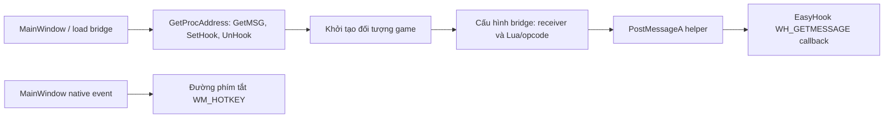

# ChickenAuto 116 và EasyHook 116 — phân tích native bằng REA/Ghidra

Ngày: 12-10-2026. Nhánh `analysis/chickenauto-116-easyhook-rea`, base `19c6720` (EAGLE Auto v0.7). Phạm vi: phân tích tĩnh và đối chiếu binary, không sửa ứng dụng hoặc DLL, không thực thi/load EXE/DLL automation, không attach game. Đây là phần tiếp theo của [đối chiếu 116–107](../chickenauto-116-vs-107/REPORT.vi.md) và [điều tra EasyHook 107](../easyhook-107-rea/REPORT.vi.md).

## Kết luận quan trọng nhất

**EasyHook 116 có cùng toàn bộ nội dung các section với EasyHook 107 sau giải nén UPX.** Hai file cùng dài 583.168 byte, chỉ khác một byte ở file offset `0x165`: trường PE `SizeOfHeaders` là 1.024 ở bản giải nén 107 và 4.096 ở DLL 116. Chuẩn hóa riêng trường này trong RAM làm hai file giống hoàn toàn; không ghi bản chuẩn hóa ra DLL.

Do đó DLL 116 không cung cấp một recv wrapper/installer mới để chữa các lỗi của 107. Các lỗi/rủi ro reader đã tìm thấy ở 107 vẫn hiện diện trong code của DLL 116. Khác biệt packer/header có thể ảnh hưởng đường load; **chưa chứng minh loader tương đương trên Windows**, cũng chưa chứng minh nguyên nhân lỗi thực tế của client. Không thay DLL chỉ vì stable 116 mở được.

Ghidra nhận diện **37.207 procedure trong EXE** và **4.140 trong DLL**; phần lớn gồm Qt/CRT và inference của provider, không phải số tính năng hoặc số hàm đã khôi phục đúng. Inventory đầy đủ đã export vào file private; 22 truy vấn app chọn lọc và các truy vấn DLL thành công. [Hồ sơ phiên/CLI/cleanup](evidence/session-validation.json) ghi rõ từng mức bằng chứng.

Phía executable 116 là **native C++ x86, Qt 5.7.1**, còn 107 là C# WinForms. REA/Ghidra khôi phục được các thân hàm chọn lọc thành pseudocode và assembly, giúp truy vết boundary và controller. Chưa có source C++ gốc, project Qt build lại được hoặc toàn bộ kiểu dữ liệu đã xác nhận; không có phép merge source trực tiếp giữa hai bản.

## Binary được phân tích

| Đối tượng | SHA-256 | Cấu trúc |
|---|---|---|
| `ChickenAuto.exe` trong `ChickenAuto-new.zip` | `34e4440dcef979de67a69478fc4165a6818d4d41e4a1b23a83ea11d49ed4ffea` | PE32/x86 GUI, 13.757.952 byte, không CLR |
| `:/Resources/EasyHook.dll` trong cây Qt rcc của payload | `f22b7f349f20f94327c365d47a56484092c45dba3fa6b4fa76231f4f49336cef` | PE32/x86 DLL, 583.168 byte |
| EasyHook 107 nguyên bản nhúng | `1017f117193687302d3817d66cb9e7914c026d78aced4a02517a5c940efe5d79` | UPX, 202.240 byte |
| EasyHook 107 giải nén bằng UPX 5.2.1 | `5d8542b7e4dda25d2d8a391d6e33d830f7e256cd18fbb5ef9cf199fdb17c48d0` | Bản sao phân tích, 583.168 byte |

`ChickenAuto-new.exe` ở root là wrapper tự giải nén PE x64, không phải ứng dụng x86 116 cần decompile. Đợt này lấy payload từ ZIP đã pin hash và trích DLL qua parser cây Qt rcc đã kiểm tra; không chạy wrapper. Cả sáu release file gốc được đối chiếu lại SHA trước/sau.

Executable không import Qt5 DLL, có Qt metadata/resource và implementation runtime trong image; điều này phù hợp static linking Qt. Direct imports là các DLL hệ thống Windows, gồm kernel/user32, GDI, OLE, Winsock, Crypt32, PSAPI, WinMM, IPHLPAPI, ADVAPI/IMM32/Shell. Các import Winsock trong EXE cũng có thể thuộc Qt network, không tự chứng minh đó là reader đọc game. Các module game được bridge nhắc đến cần client thực tế để xác minh.

PE version resource của EXE ghi `FileVersion/ProductVersion=1.0.0.0`, không phải số sản phẩm 116. Image base ưu tiên EXE `0x400000`, DLL `0x10000000`; entrypoint tương ứng `0xbd4e4d` và `0x1002501a`. Các VA trong báo cáo là tọa độ static image, không phải địa chỉ process sau ASLR và không phải offsets để cập nhật client private.

## EasyHook: những điểm đã xác nhận

| Boundary | VA DLL | Kết quả tĩnh |
|---|---|---|
| `GetMSG` | `0x10004110` | Trả registered Windows message ID, không trả recv data |
| `SetHook(HWND)` | `0x10005630` | IsWindow → GetWindowThreadProcessId → SetWindowsHookExA loại 3, trả 0/1, `RET 4` |
| `UnHook(HWND)` | `0x10005890` | UnhookWindowsHookEx và xóa state WH hook; không restore/free recv detour trong export này |
| Callback | `0x10004120` | Lệnh `-5` lưu receiver, `-10` thiết lập PID/descriptor và gọi installer |
| Recv wrapper | `0x100052c0` | Gọi trampoline recv, trả nguyên n, chỉ thông báo nếu `15<n<1000` và receiver khác 0 |
| Installer | `0x10002810` | Chép 5 byte prologue, trampoline 10 byte, JMP rel32, không decode/relocate instruction trong hàm |

Các section `.text/.rdata/.data/.gfids/.tls/.rsrc/.reloc`, imports, globals và code ở các boundary đều trùng. REA/Ghidra đọc riêng DLL 116 xác nhận kết quả, không chỉ suy từ tên export hoặc kích thước. Có 4.140 procedure được provider nhận diện, bao gồm runtime/CRT và các inference, không phải 4.140 tính năng.

Recv wrapper ghi PID4 + n byte vào buffer nhưng đặt `COPYDATA.cbData=n`: phía nhận chỉ thấy PID4 + n−4 byte, mất bốn byte cuối của bản sao thông báo. Ví dụ 20 byte `abcdefghijklmnopqrst` trở thành PID4 + `abcdefghijklmnop`. Buffer/kết quả recv gốc không bị wrapper thay đổi, nên không kết luận stream game cũng mất byte.

Rủi ro khác giữ nguyên: bỏ chunk nhỏ/lớn, không framing/reassembly, static buffer dùng chung trong một process không có đồng bộ ở wrapper, SendMessageA đồng bộ không timeout, không kiểm tra kết quả các API cài detour, không guard cài lặp trong nhánh callback đã đọc, không FlushInstructionCache trong installer và không ACK cho C#. Callback sử dụng stack arguments nhưng kết thúc bằng `RET` thay vì `RET 12`; đây vẫn là dấu hiệu ABI cần harness Windows, không phải kết luận ứng dụng chắc chắn crash.

## Phía ứng dụng 116: đường hook đã truy được

Tên vai trò dưới đây do phân tích gán từ Qt metadata/RTTI, call graph và instructions; không phải symbol từ PDB gốc.



- Constructor/load path tham chiếu `Bin/EasyHook.dll` và `:/Resources/EasyHook.dll`; resolve ba export rồi gọi GetMSG và lưu function pointers. Nhánh thiếu DLL/export có đường báo lỗi. Điều này xác nhận app dùng resource đã trích, không mặc định là package EasyHook bên ngoài.
- Function `0x426ae0` là boundary khởi tạo game được chọn: gọi con trỏ SetHook khi đã resolve, sau đó dựng/configure bridge và cập nhật flag hiển thị từ IsWindowVisible. **Không kiểm tra giá trị trả về của SetHook tại lệnh gọi đã đọc.**
- Function `0x426bb0` chuyển hai tham số vào `PostMessageA(HWND, registeredMsg, wParam, lParam)`. Asm giữ EAX sau API và `RET 8`; nhiều caller cấu hình tiếp tục sau lệnh gọi. Không có ACK reader qua helper này.
- Configure path `0x421da0` có lệnh `-5` với receiver HWND rồi các lệnh cấu hình bridge. Việc gửi receiver chưa chứng minh ứng dụng yêu cầu/có dùng recv reader.
- MainWindow virtual slot `0x411aa0` chuyển native event tới `0x41f800`. Handler được đọc chỉ xử lý `WM_HOTKEY=0x312`, trả false cho message khác. **Đường này không nhận/parse WM_COPYDATA.** Chưa thể suy ra mọi đường khác đều không có reader: filter, indirect calls, computed arguments và các thread khác chưa truy hết.
- Trong subset code `0x401000..0x443000`, objdump tìm được 62 direct call site tới helper `0x426bb0`, một immediate `-5`, không thấy immediate push `-10`. Đây là bằng chứng giới hạn theo subset/cú pháp, không phải chứng minh toàn bộ EXE không thể gửi `-10`.

### Dấu hiệu calling convention phía 116

Caller tại `0x426b1b` PUSH HWND, `0x426b1d` CALL con trỏ SetHook, rồi `0x426b1f` ADD ESP,4. Trong DLL, SetHook tự dọn tham số bằng `RET 4` cả nhánh thành công và thất bại. Không có padding allocation tương ứng trong đoạn caller đã đọc. Đây là **dấu hiệu dọn stack hai lần tại boundary**; cần harness x86 để đo ESP và xác minh tác động thực tế. Frame pointer/nhánh điều kiện có thể ảnh hưởng cách biểu hiện lỗi; chưa có runtime trace để kết luận crash hoặc giải thích vì sao stable mở được.

Không port declaration con trỏ hàm của 116 sang C# theo pseudocode. PInvoke Winapi/stdcall mặc định của v0.7 vẫn giữ nguyên; đợt này không sửa ABI, callback hoặc bất kỳ DLL nào.

## Cấu trúc và tính năng thường

Qt metadata trước đây xác định 16 metaobject và 256 mục dịch. Đợt này bổ sung liên kết RTTI/vtable tới controller và worker, rồi decompile các hàm ứng viên. Source đầy đủ của constructor/controller/worker giữ ngoài Git để tránh xuất bản các constant/nhánh ngoài phạm vi; evidence công khai gồm bản đồ và trích đoạn được review.

| Lớp/nhóm | Anchor được chọn | Điều có thể dùng để cải thiện 107 |
|---|---|---|
| `game_controllers::game_auto_controllers::AutoAttack` | RTTI, vtable thứ hai trỏ `0x4053f0` | Phân tách controller đánh quái, so từng guard/điều kiện bằng giả lập trước khi port |
| `AutoPickLootPackage` | RTTI, vtable thứ hai trỏ `0x406000` | Phân tách nhặt loot và kiểm tra lựa chọn/di chuyển, chưa nối vào thao tác game |
| `AutoControllerAbstract` | Vtable có purecall tương ứng slot controller | Có abstraction controller, không chứng minh scheduler tốt hơn 107 |
| `WorkerDetectGameInstance` | Metaobject/RTTI, virtual routine `0x415930` | Tách phát hiện/đọc game với UI; cần benchmark trước khi thay scheduling |
| `WorkerUpdateUi` | Metaobject/RTTI, virtual routine `0x417820` | Đánh giá snapshot UI và cadence cập nhật bằng dữ liệu giả |
| BasicSettings | Static metacall `0x43e1e0` và tên slot | Bật/ngưỡng HP, MP, pet riêng; đối chiếu mapping với 107 đã sửa UI |
| QuestSettings | Không Qt methods trong metaobject, stub `0x408270` | Chưa thấy engine phó bản tương đương từ các anchor này; lambda/direct call có thể không xuất hiện trong MOC |

### Một rủi ro đọc trạng thái cần tránh khi học từ 116

Ba getter được đọc bằng objdump ở `0x425a00`, `0x425b10`, `0x425320` gọi ReadProcessMemory nhưng **không kiểm tra BOOL hoặc số byte đọc**, rồi so sánh/trả local stack buffer. Stack slot được tạo bằng PUSH ECX, không được khởi tạo thành một kết quả lỗi có kiểu. Nếu đọc thất bại/thiếu, giá trị cũ có thể bị diễn giải như trạng thái hợp lệ. Chưa xác minh ý nghĩa game của mọi field; không tự gán các getter thành “đã chết/HP/đang chuyển map” chỉ dựa vào tên suy đoán.

AutoAttack routine chọn lọc gọi chính các getter này trước delegate `0x403c70`. Vì thế không nên port những guard ấy như một bản đã chắc chắn tốt hơn 107. Hướng cải thiện là adapter đọc trạng thái trả kết quả rõ ràng, kiểm tra BOOL/count và dừng quyết định khi snapshot không hợp lệ; mô phỏng read failure trước khi đổi code. V0.7 mới kiểm tra các API liên quan hook/recv, không tuyên bố toàn bộ getter game legacy đã được sửa.

[AutoAttack excerpt](evidence/app-auto-attack-excerpt.txt) cho thấy routine virtual chủ yếu kiểm tra các getter rồi delegate, không phải toàn bộ thuật toán chọn quái. [AutoLoot excerpt](evidence/app-auto-loot-excerpt.txt) có phase, kiểm tra khoảng cách `2.0`, lệnh nhặt `0x6a` và các ngưỡng timer raw `300/500/2000/55000/60000` ở thân đầy đủ. Đây là các anchor cho mô phỏng state/timeout, chưa xác nhận đơn vị timer, đơn vị khoảng cách hoặc contract các callee trên client private. Không chép các hằng ấy sang 107.

Không đánh đồng thân controller candidate với source hoàn chỉnh hoặc hành vi đã PASS. Chưa đối chiếu hết các callee và kiểu object; helper CRT/Qt có thể mang tên do Ghidra suy ra. Các địa chỉ field trong đối tượng auto 116 không phải cấu trúc memory client TLBB. Giữ các sửa phó bản của 107 và chưa thay engine theo 116 trong lượt này.

## Công cụ, giới hạn và khả năng tái lập

REA 6.4.0, Ghidra 12.1.4, full JDK Temurin 21.0.12.1+1; UPX 5.2.1, Python dnfile/pefile và GNU objdump. REA doctor scope Ghidra healthy trên máy này; báo cáo hỗ trợ host/optional integrations độc lập vẫn có hạn chế Debian 13 như đợt trước. Không cài thêm debugger runtime hoặc đăng ký MCP vào user config.

Executable lớn vượt deadline mặc định 330 giây; lần sau dùng `REA_GHIDRA_STARTUP_TIMEOUT_MS=900000` riêng cho app. Full inventory vượt receive budget MCP 10 MiB, không bị cắt mất dữ liệu bởi provider. Cần export canonical evidence ra file hoặc dùng CLI complete JSON; truy vấn từng function vừa budget. Các lỗi decompile/image-data inference ở phần thư viện có trong log, không chứng minh binary gốc hỏng. Không có PDB để xác nhận mọi tên/type.

Tái lập input và so byte (Python venv có dnfile/pefile, sau activation toolchain):

```bash
source /workspace/rea-tools/activate.sh
/workspace/chickenauto-investigation/tools/venv/bin/python analysis/chickenauto-116-rea/tools/prepare_inputs.py
/workspace/chickenauto-investigation/tools/venv/bin/python analysis/chickenauto-116-rea/tools/compare_dlls.py
/workspace/chickenauto-investigation/tools/venv/bin/python analysis/chickenauto-116-rea/tools/inspect_metadata.py
```

Tái lập truy vấn chọn lọc (thư mục output phải chưa tồn tại):

```bash
export REA_GHIDRA_STARTUP_TIMEOUT_MS=900000
python analysis/chickenauto-116-rea/tools/make_requests.py --target app --output .build/chickenauto-116-rea/app-requests.json
python analysis/chickenauto-116-rea/tools/rea_batch.py --requests .build/chickenauto-116-rea/app-requests.json --output .build/chickenauto-116-rea/app-replay
```

Đổi `--target hook` và output tương ứng để phân tích DLL. Có thể cung cấp `--snapshot` cho make_requests để tái dùng phiên đúng target/profile. Batch helper đã được kiểm tra với REA thật trên DLL: open/decompile/summary/export/close thành công. Helper chỉ cho phép static operations, tiếp tục export khi inventory vượt transport budget, giữ snapshot trước đóng phiên; không cắt response hoặc coi transport error là decompile thành công. Thời gian cold analysis của EXE lớn có thể nhiều phút. Snapshot chứa những quan sát đã có, không bảo đảm mọi truy vấn mới tránh được cold initialization.

REA cần đầu vào ở ignored `.build/chickenauto-116-rea`; raw responses, full inventory, snapshot và binary không được commit. [prepare_inputs.py](tools/prepare_inputs.py) xác minh resource qua cây Qt; [compare_dlls.py](tools/compare_dlls.py) kiểm tra mọi byte, không mutate DLL. [verify_preservation.py](tools/verify_preservation.py) bảo vệ toàn bộ app/tests/version/CI và snapshot so với v0.7, chỉ cho phép thêm báo cáo ở thư mục này.

Chưa có kiểm thử Windows/game, không nạp DLL để kiểm tra calling convention, không xác thực IPC origin/ACK, không benchmark CPU/UI hoặc thử gameplay 116–107. Không phân tích để bypass licensing/VIP/auth hoặc sửa server-side access. Không chạy lại 552 test app cho thay đổi chỉ có phân tích; kết quả v0.7 trước đó không được dùng để chứng nhận 116.

## Hướng đi tiếp theo

Giữ v0.7 và bộ mô phỏng reader đã có. Ưu tiên harness Windows x86 source-controlled với cửa sổ và receiver giả để kiểm tra calling convention, ACK/lifecycle, framing vận chuyển và bounded delivery. Khi viết detour mới, dùng cơ chế giải mã/relocate instruction đúng; giữ bridge/opcode/licensing riêng. Kết quả này củng cố nhu cầu sửa reader từ source có kiểm thử, không cung cấp DLL 116 đã chữa lỗi để thay trực tiếp.

Với tính năng thường, chọn một hành vi cụ thể của AutoAttack/AutoPickLootPackage, khôi phục contract/guard và các callee cần thiết, rồi đưa vào mô phỏng đối chiếu trước khi đổi 107. Không đổi scheduler/UI toàn diện chỉ vì có worker riêng. Kiểm thử các phụ bản trong game tiếp tục đợi hoàn tất các đợt rà soát theo thống nhất với người dùng.
