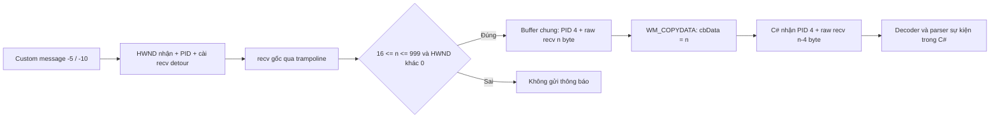

# EasyHook.dll 107 — phân tích bằng REA/Ghidra

Ngày 12-10-2026 (Asia/Bangkok). Nhánh `analysis/easyhook-107-rea`, base `1ff6bd5` (EAGLE v0.6).

## Kết luận

**REA đã phân tích được mã native của EasyHook107 sau khi giải nén UPX tĩnh.** Luồng quan trọng đã xác định là hook message trên thread của cửa sổ game → nhận lệnh cài detour `recv` → gọi recv gốc → chuyển một phần chunk qua `WM_COPYDATA` tới cửa sổ auto.

Hai giới hạn dữ liệu có bằng chứng assembly rõ: **chỉ chuyển chunk có độ dài 16–999 byte**, và **buffer thêm PID 4 byte nhưng cbData vẫn bằng độ dài recv**, nên 4 byte cuối của raw chunk không được chuyển sang C#. Điều này có thể làm nhận diện thông báo Ác Bá thiếu dữ liệu; chưa chứng minh đó là nguyên nhân của một lần lỗi trên client riêng. Native wrapper không tách packet, ghép stream, chọn kênh hệ thống hay giải mã VISCII/UTF-8.

Không sửa DLL, offsets, automation, licensing/VIP hoặc stable 116; không tăng version hay tạo EXE mới. DLL/EXE/game không được nạp hoặc thực thi. Các câu hỏi runtime Windows 11/client riêng còn cần kiểm thử có giám sát theo kế hoạch chung.

## Công cụ và khả năng đã xác minh

- REA npm **6.4.0**, Node **24.19.0**, Ghidra **12.1.4**, full Temurin JDK **21.0.12.1+1**, UPX **5.2.1**; CLI và client MCP stdio cục bộ đều dùng provider Ghidra thật. Replay helper đã chạy đủ 6 CLI query thành công; xem [CLI replay](evidence/cli-replay.json).
- SRI npm và SHA256 ba archive Ghidra/JDK/UPX được kiểm trước khi dùng. Xem [toolchain](evidence/toolchain.json), [installer tái lập](tools/install-toolchain.sh).
- REA `doctor --provider ghidra` trả scoped `healthy:true`; import/decompile/xrefs/assembly/read-bytes chạy được trên host này. Host là Debian 13/Linux x64, **ngoài danh sách distribution REA quảng bá**; full-environment health vẫn false, còn các tích hợp tùy chọn chưa cài. Không suy ra hỗ trợ toàn bộ host/Windows từ kết quả này.
- Chỉ cài công cụ trong `/workspace/rea-tools`; không sửa config Codex của người dùng. Server stdio dùng cho điều tra đã đóng; `close_binary` không báo lỗi. Một tiến trình decompiler đã kết thúc còn ở trạng thái zombie do init chưa reap; không giết tiến trình khác hay tuyên bố tất cả PID đã biến mất.
- Đã lưu install/start instructions vào cloud draft. Saving chưa Publish, chưa kiểm restoration trong task mới.

## Nhận diện và giải nén

| Artifact | Kích thước | SHA256 |
|---|---:|---|
| Resource gốc `TinhKiemAuto.EasyHook.dll` |202,240 byte|`1017f117193687302d3817d66cb9e7914c026d78aced4a02517a5c940efe5d79`|
| Bản sao giải nén bằng UPX 5.2.1 |583,168 byte|`5d8542b7e4dda25d2d8a391d6e33d830f7e256cd18fbb5ef9cf199fdb17c48d0`|

Trích resource từ payload `ChickenAutoEx.exe` trong `ChickenAutoEx-new.zip`; payload hash `11c98b8eff545fbafa5fd6e9d3d281af62aa7fac4234eb546fcc2a4d671df573` khớp điều tra gốc. `upx -t` thành công; `upx -d -o DERIVED ORIGINAL` đọc/biến đổi file, không chạy entry point. Original giữ nguyên.

REA nhìn bản nén có section UPX0/UPX1, **7 procedure, 15 string**. Bản giải nén có `.text/.rdata/.data/.gfids/.tls/.rsrc/.reloc`, **4,140 procedure, 841 string** theo database Ghidra. Số này không phải số tính năng/source file; có code CRT và hàm phân tích suy ra. Architecture PE32/x86, preferred image base `0x10000000`, vai trò DLL.

Kích thước583,168 trùng DLL 116 từng ghi trong báo cáo, nhưng hash bản giải nén **khác** hash DLL 116 `f22b7f349f20f94327c365d47a56484092c45dba3fa6b4fa76231f4f49336cef`. Không kết luận hai DLL tương đương hoặc có thể thay ngang. Lượt này không decompile DLL 116.

[Inventory](evidence/inventory.json) nối hash resource gốc → phép biến đổi UPX → hash artifact phân tích → Evidence IDs/projection. Raw canonical responses, snapshot và binary nằm trong `.build/easyhook-107-rea`, ngoài Git. Excerpt được ghi rõ là projection, không giả làm canonical REA Evidence mới.

## Ba export và giao thức điều khiển

Địa chỉ dưới đây là VA **preferred image base của artifact đã giải nén**, không phải địa chỉ runtime game/ASLR hoặc offsets cần cập nhật.

| Export | VA | Hành vi quan sát |
|---|---|---|
| GetMSG |`0x10004110`|Trả global `0x100a2570`, là ID custom window message; không phải hàm trả dữ liệu nhận từ server.|
| SetHook |`0x10005630`|Nhận **HWND**, kiểm IsWindow, lấy thread cửa sổ, gọi SetWindowsHookExA với hook 3 (`WH_GETMESSAGE`), callback `0x10004120`; trả EAX0/1. Assembly RET4 xác nhận một tham số stack/callee cleanup.|
| UnHook |`0x10005890`|Nhận HWND; nếu IsWindow thì gọi UnhookWindowsHookEx bằng HHOOK global và xóa globals. Không phục hồi recv detour hoặc giải phóng trampoline trong export này. RET4.|

Xem các [pseudocode](evidence/SetHook-unpacked.txt) và [assembly](evidence/SetHook-assembly.txt). Source C# `Game.Init()` gọi `SetHook(Handle)` nhưng bỏ qua kết quả; tên `proseccid` trong khai báo khác của FrmMain dễ gây nhầm, dữ liệu thực là window handle.

REA đọc được 17 byte tại `0x10001020`, khớp objdump độc lập: gọi import RegisterWindowMessageA và ghi EAX vào `0x100a2570`. Ghidra **không định nghĩa function ở vị trí initializer này**, nên không lấy được pseudocode hay chứng minh toàn bộ startup call chain bằng function graph. Xem [byte observation](evidence/registered-message-init-bytes.json), [objdump](evidence/registered-message-init-objdump.txt).

Callback kiểm `MSG.message` ở +4 bằng custom message ID; `MSG.wParam` ở +8 và `MSG.lParam` ở +12:

- `lParam=-5`: lưu wParam làm HWND nhận dữ liệu. C# `Game.SetDll()` gửi `FrmMain.Instance.Handle`.
- `lParam=-10`: lưu wParam làm nhãn PID, tách 4 byte little endian vào đầu buffer; thiết lập descriptor gồm wrapper `0x100052c0`, địa chỉ recv import và trampoline; gọi installer `0x10002810`.
- Không thấy ACK cài hook gửi về C# ở nhánh này. Các lệnh Lua/automation khác được bỏ khỏi evidence công khai của lượt điều tra.

Callback trong pseudocode có signature `__fastcall`/register parameters và return void suy ra. Assembly cho thấy 3 tham số stack và **RET trần**, trong khi ABI HOOKPROC thông thường yêu cầu CALLBACK/__stdcall. Đây là rủi ro gọi hàm cần xác nhận trên Windows; không dùng prototype decompiler như source C++ gốc hoặc tự sửa calling convention dựa trên nó.

## recv → WM_COPYDATA



Wrapper `0x100052c0` giữ nguyên return value của recv gốc. Việc thiếu dữ liệu ở đây xảy ra ở **bản sao thông báo cho auto**, không chứng minh game mất dữ liệu socket.

Bố cục x86 COPYDATASTRUCT dựng trên stack: dwData=0, cbData=n, lpData trỏ buffer chung. Wrapper gọi `SendMessageA(receiver,0x4a,n,&copydata)` đồng bộ. Vòng copy ghi payload tại buffer[4..n+3], nhưng Windows chỉ chuyển cbData=n byte từ buffer[0].

Ví dụ mô hình thuần byte: recv 20 byte `abcdefghijklmnopqrst`; auto nhận PID 4 byte và `abcdefghijklmnop`; `qrst` không được chuyển. Chưa biết protocol client có trailer/checksum4 byte không. Dù có, recv là chunk stream và không tự bảo đảm chunk trùng biên packet, nên không đủ bằng chứng để xem việc bỏ 4 byte này luôn đúng.

Không có packet-length parser, reassembly hoặc Unicode decoder trong wrapper. Opcode/channel, body offset, mã chữ và nội dung Ác Bá phải xác minh độc lập từ client/protocol. [Pseudocode](evidence/recv-wrapper.txt), [assembly](evidence/recv-wrapper-assembly.txt) và 24 [offline byte checks](evidence/byte-layout-checks.json) chứng minh bố cục/giới hạn đã quan sát, **không phải Windows/DLL execution test**.

## Các phát hiện cần xử lý tiếp

| Mã | Bằng chứng | Ảnh hưởng/giới hạn |
|---|---|---|
| EH01 |UPX che thân code ở file nén; hash/procedure count khác sau giải nén.|Đã giải quyết cho phân tích bằng bản sao. Không cần thay DLL trong app.|
| EH02 |Chỉ forward 16–999 byte, từng lần recv riêng.|Chunk nhỏ/lớn không được quan sát; packet cắt/ghép có thể bị bỏ. Tần suất trên client chưa biết.|
| EH03 |Ghi n+4 byte, gửi cbData=n.|4 byte cuối raw chunk không sang C#; UTF-8 có thể bị cắt giữa codepoint. C# không thể khôi phục những byte đã bị bỏ. Ý nghĩa trailer chưa xác minh.|
| EH04 |Buffer/PID global dùng chung, không có synchronization trong wrapper.|Nếu nhiều thread gọi recv đồng thời hoặc reentrancy, có thể ghi đè dữ liệu đang chuyển. Chưa chứng minh client có tình huống đó.|
| EH05 |SendMessageA đồng bộ, không timeout, return không kiểm.|Game recv thread có thể chờ UI auto; nhận thất bại có thể im lặng. Chưa đo latency/deadlock thực tế.|
| EH06 |Installer chép cố định 5 byte đầu recv, tạo trampoline 10 byte; không decoder/relocation trong function này.|Phụ thuộc prologue đúng 5 byte, không PC-relative cần sửa. Chưa đọc ws2_32.dll của Windows 11/client để xác nhận. Không suy ra startup TLS cũ do lỗi này.|
| EH07 |VirtualProtect/VirtualAlloc/WriteProcessMemory không kiểm kết quả; không thấy FlushInstructionCache trong installer.|Allocation/patch failure có thể bị dùng như thành công hoặc dereference null; visibility và thread safety cần kiểm runtime.|
| EH08 |-10 luôn cài mới, không guard trong nhánh; bỏ qua PM_REMOVE/PM_NOREMOVE.|Yêu cầu lặp hoặc PeekMessage không remove có thể cài lại detour, leak trampoline/chaining sai. Mỗi lần VirtualAlloc10 nhưng không free cũ trong installer; chưa xác minh game message loop.|
| EH09 |Callback RET trần, export SetHook/UnHook RET4.|Có dấu hiệu ABI callback lệch chuẩn; cần harness Windows trước kết luận mức độ lỗi. Pseudocode không đủ chứng minh signature.|
| EH10 |C# Init bỏ qua SetHook return; Game.PostMessage bỏ qua PostMessage BOOL; IsHooked được gán sau yêu cầu gửi.|Các cờ managed không chứng minh WH_GETMESSAGE hay recv detour đã cài. v0.6 đã kiểm đọc đủ10 byte trước request, nhưng chưa có native ACK.|
| EH11 |UnHook export chỉ tháo Windows hook; C# UnHookRecv phục hồi 10 byte bằng WriteProcessMemory.|Hai tầng cleanup khác nhau; kết quả WriteProcessMemory chưa được kiểm. Callback export không tự giải phóng recv trampoline. Native allocation lifetime toàn DLL chưa được truy vết đầy đủ.|

.data không có MEM_SHARED theo PE flags. Vì vậy không coi buffer là dùng chung giữa mọi process; rủi ro EH04 là các thread/reentrancy **trong cùng DLL instance/process**. SetHook giữ HHOOK/target HWND trong globals mỗi process, cần kiểm ownership khi nhiều character/window. Không suy ra chắc chắn multi-account hỏng chỉ từ globals.

## Đối chiếu với EAGLE v0.6

`FrmMain.WndProc` đọc PID từ 4 byte đầu và copy cbData byte; đây đúng với prefix native đã quan sát. `AcBaEvents.TryDecodeSystem` chỉ nhận frame đầu với signature/header baseline ở offsets4/5/10 và body15. DLL không cung cấp chứng cứ những offsets ấy luôn là biên packet.

V0.6 từ chối framing không rõ, có chọn môn phái thủ công và timeout. Đây vẫn là phương án hiện tại khi reader không tương thích. Không nên nới parser để tìm chữ Ác Bá ở bất kỳ vị trí nào trong raw chunk: dữ liệu có thể thiếu, ghép hoặc chứa chat của người chơi.

Native gate/truncation có thể giải thích một số thông báo không tới parser; **chưa chứng minh tự nhận diện Ác Bá hoạt động trên private client**. Sửa parser C# đơn thuần không giải quyết được dữ liệu đã bị native bỏ.

## Chiến lược sửa đề xuất

1. **Thêm chẩn đoán managed hẹp trước:** kiểm kết quả SetHook/PostMessage/WriteProcessMemory, phân biệt trạng thái yêu cầu gửi với có dữ liệu nhận; hiển thị lý do dừng/reader không sẵn sàng. Không dùng việc ghi được 10 byte làm ACK native.
2. **Dựng native reader thử nghiệm riêng**, giữ DLL gốc và command/Lua bridge hiện tại. Thiết kế envelope có version/PID/length/status, copy đủ dữ liệu, ownership buffer rõ, delivery có hạn và hook idempotent. Phải xác minh trailer/protocol trước sửa cbData và codec. Không đổi packet gửi tới server hay điều kiện licensing/VIP.
3. **Mô phỏng trước khi ghép vào app:** recv trả lỗi/0/nhỏ/lớn, stream cắt/ghép, Unicode cắt, nhiều thread, UI chậm, nhận HWND lỗi, lệnh cài lặp, thất bại allocation/patch và cleanup. Chọn thư viện detour phù hợp với instruction relocation thay vì chép 5 byte tùy ý; kiểm dependency/ABI riêng.
4. **Harness Windows 11 có source kiểm soát được:** xác nhận HOOKPROC ABI, current ws2_32 prologue, quyền/bitness, hook/unhook và delivery. Bước chạy original/game vẫn theo ràng buộc người dùng và chỉ khi được phép; không coi Linux static analysis/model là kiểm game.
5. Sau bằng chứng/harness, mới chọn bản vá nhỏ để tích hợp rồi kiểm tổng hợp các phó bản. Không chuyển hàng loạt chức năng nhạy cảm hoặc thay DLL 116 chỉ vì có chung export.

## Tái lập và phạm vi bảo toàn

```bash
bash analysis/easyhook-107-rea/tools/install-toolchain.sh
source /workspace/rea-tools/activate.sh
# Extract ORIGINAL from pinned release as data into ignored .build.
/workspace/rea-tools/upx-5.2.1-amd64_linux/upx -t ORIGINAL_DLL
/workspace/rea-tools/upx-5.2.1-amd64_linux/upx -d -o DERIVED_DLL ORIGINAL_DLL
rea analyze DERIVED_DLL --provider ghidra --format json
rea decompile DERIVED_DLL 0x100052c0 --provider ghidra --format json
rea instructions DERIVED_DLL 0x100052c0 --provider ghidra --format json
python analysis/easyhook-107-rea/tools/check_byte_layout.py
```

Dùng đường dẫn thực; ORIGINAL/DERIVED là hai file khác nhau. Chạy bằng Python venv có `dnfile` từ workflow điều tra, sau khi activate toolchain. [Replay helper](tools/replay_static.py) có thể trích resource, giải nén và chạy các CLI chọn lọc, giữ raw responses trong .build. Collector chiếu evidence từ các raw MCP response của lượt này; không chạy DLL hoặc tự đăng ký Codex integration.

Xem [kiểm tra bảo toàn](evidence/preservation.json). Application source/project/test/lockfile, six release binaries và snapshot C# không đổi so với base. Không rebuild ứng dụng cho commit chỉ chứa phân tích/công cụ tái lập; 488 test của v0.6 là kết quả đợt trước, **không gán lại thành native tests**. Chỉ 24 byte-layout checks và thao tác REA/Ghidra tĩnh nêu trên được chạy trong lượt này. Không khôi phục project C++ đầy đủ, không có PDB/source native gốc, không chứng minh source decompile tương đương runtime.
